<a href="https://github.com/dxmoc">
  <picture>
    <source media="(prefers-color-scheme: dark)" srcset="assets/header-dark.svg">
    <source media="(prefers-color-scheme: light)" srcset="assets/header-light.svg">
    
  </picture>
</a>

I build small, self-contained tools for problems I actually have. If something
needs a package manager just to start, I usually keep rewriting it until it
does not.

## Things I made

| | What it does | Built with |
| --- | --- | --- |
| [**ventoy-iso-updater**](https://github.com/dxmoc/ventoy-iso-updater) <br>  | Keeps every ISO on a Ventoy stick current. Finds new versions on its own, downloads only what changed and removes what it replaced. Windows, Linux, macOS, WSL. | <picture><source media="(prefers-color-scheme: light)" srcset="https://skillicons.dev/icons?i=py&theme=light"></picture><br><sub>standard library only</sub> |
| [**sc-outfitter**](https://github.com/dxmoc/sc-outfitter) <br>  | The best loadout you can actually buy for a Star Citizen ship, plus the shopping route through Stanton, Pyro and Nyx. Also plans the trip for an erkul.games build. | <picture><source media="(prefers-color-scheme: light)" srcset="https://skillicons.dev/icons?i=cs,dotnet&theme=light"></picture><br><sub>WPF, no NuGet packages</sub> |
| [**LiquidFin**](https://github.com/dxmoc/jellyfin-liquidfin-theme) <br>  | Liquid Glass for Jellyfin: translucent panes, refracted edges, capsule controls. One stylesheet, no JavaScript, no external requests. | <picture><source media="(prefers-color-scheme: light)" srcset="https://skillicons.dev/icons?i=css&theme=light"></picture><br><sub>one stylesheet</sub> |
| [**aniworld-cli**](https://github.com/dxmoc/aniworld-cli) <br>  | Lean terminal client for aniworld.to. Search, pick, watch in mpv. Streaming only, German interface. | <picture><source media="(prefers-color-scheme: light)" srcset="https://skillicons.dev/icons?i=py&theme=light"></picture><br><sub>mpv for playback</sub> |

## Toolbox

<picture><source media="(prefers-color-scheme: light)" srcset="https://skillicons.dev/icons?i=py,cs,dotnet,css,githubactions,git&theme=light"></picture>

## House rules

<table>
<tr>
<td width="50%" valign="top">

**Nothing to install.** The standard library is enough more often than people think.

**One file beats a framework.** A theme is a stylesheet, a tool is a script.

**No phoning home.** No accounts, no telemetry, no requests nobody asked for.

</td>
<td width="50%" valign="top">

**Say what is untested.** A README that names its gaps beats one that hides them.

**Boring beats clever.** It should still run next year without me touching it.

**Clean up after yourself.** Replace the old version, do not pile up new ones.

</td>
</tr>
</table>

## Lately

<table>
<tr>
<td width="50%" valign="top">

**Releases**

<!-- releases:start -->
[ventoy-iso-updater v0.9.0](https://github.com/dxmoc/ventoy-iso-updater/releases/tag/v0.9.0) <sub>2026-10-14</sub>

[jellyfin-liquidfin-theme v0.2.4](https://github.com/dxmoc/jellyfin-liquidfin-theme/releases/tag/v0.2.4) <sub>2026-09-08</sub>

[sc-outfitter v1.3.0](https://github.com/dxmoc/sc-outfitter/releases/tag/v1.3.0) <sub>2026-09-07</sub>

[aniworld-cli v0.1.2](https://github.com/dxmoc/aniworld-cli/releases/tag/v0.1.2) <sub>2026-07-15</sub>
<!-- releases:end -->

</td>
<td width="50%" valign="top">

**Elsewhere on GitHub**

<!-- elsewhere:start -->
[anmolkapil/plexo#133](https://github.com/anmolkapil/plexo/pull/133) PR: feat: NZB downloads from a Usenet news server (#126) <sub>2026-10-15</sub>

[anmolkapil/plexo#126](https://github.com/anmolkapil/plexo/issues/126) issue: Feature request: NZB / Usenet downloads <sub>2026-10-14</sub>

[awesome-jellyfin/awesome-jellyfin#627](https://github.com/awesome-jellyfin/awesome-jellyfin/pull/627) PR: feat: add LiquidFin theme <sub>2026-10-13</sub>

[flipperdevices/flipperone-linux-build-scripts#115](https://github.com/flipperdevices/flipperone-linux-build-scripts/issues/115) issue: Lock /boot with btrfs property RO <sub>2026-10-12</sub>

[paulherter/swiftly-player#12](https://github.com/paulherter/swiftly-player/issues/12) issue: Feature request: show Jellyfin playlists (video playlists) <sub>2026-10-10</sub>
<!-- elsewhere:end -->

</td>
</tr>
</table>

## Get in touch

Questions about one of my projects, an idea, or something that does not fit
into an issue: mail me at **[mail@corvyn.org](mailto:mail@corvyn.org)**. My
inbox is always open.

Encrypted mail is welcome. Fingerprint
`3F3F EB4D 9CED 560F 4E44  F407 0353 506E 0CC7 2C99`, key as
[`publickey.asc`](publickey.asc) or right here:

<details>
<summary>PGP public key</summary>

```
-----BEGIN PGP PUBLIC KEY BLOCK-----

xjMEanmRLxYJKwYBBAHaRw8BAQdAX+/T/3gVISmaUX1/c/iIsX+Ff/FsdqsE
vyfWrxT5J4TNIW1haWxAY29ydnluLm9yZyA8bWFpbEBjb3J2eW4ub3JnPsLA
EQQTFgoAgwWCanmRLwMLCQcJEANTUG4MxyyZRRQAAAAAABwAIHNhbHRAbm90
YXRpb25zLm9wZW5wZ3Bqcy5vcmcPajuMPQrtxDdDbdzoe0My/fbqkV5dMpia
m54I4J6cWgMVCggEFgACAQIZAQKbAwIeARYhBD8/602c7VYPTkT0BwNTUG4M
xyyZAACpogEA//AKy8mQjDtccvOl3agtzikSh8MF6ML3mdy68UZa4IsBAMBY
7jhIAhIzR2nLtymCT0gZz873YOIWaYWPyFv4IXsEzjgEanmRLxIKKwYBBAGX
VQEFAQEHQP2v1uwYw3NA9RX+Zreepp3ZxJX/WUlLT8LHWGQSsQxxAwEIB8K+
BBgWCgBwBYJqeZEvCRADU1BuDMcsmUUUAAAAAAAcACBzYWx0QG5vdGF0aW9u
cy5vcGVucGdwanMub3Jn6caBZSuvgS+Zc8vdEDjo15iQBOQbURqpTNdL6GO2
mwECmwwWIQQ/P+tNnO1WD05E9AcDU1BuDMcsmQAAwJkBAPH2zsMtXCt8r0N3
4rNfDoNCWBBalYLjU0aUurMyq9OeAQDzIWIqwydALsptm+PBmDF8KXwrGl2w
zN0DC7GazTXlBw==
=em3m
-----END PGP PUBLIC KEY BLOCK-----
```

</details>

<sub>The header is drawn by <code>scripts/make_header.py</code>, the lists above refresh themselves once a day. Both use nothing but the Python standard library, of course.</sub>

<p align="right"><i>See you Space Cowboy!</i></p>
